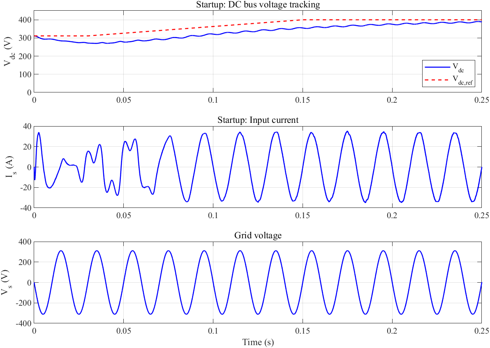
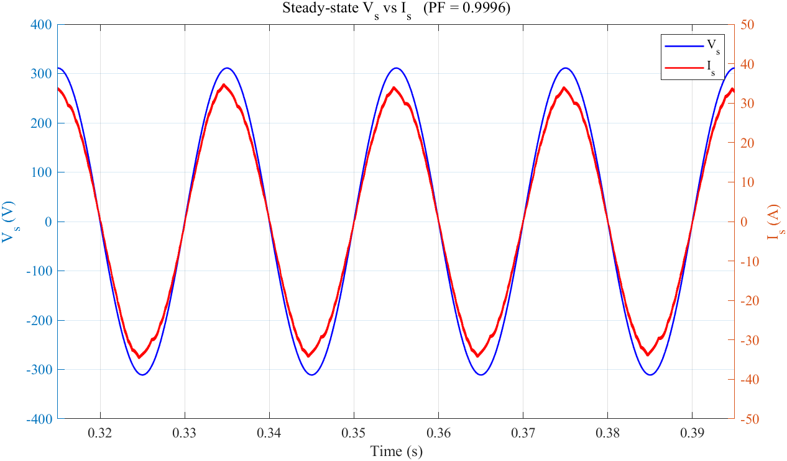
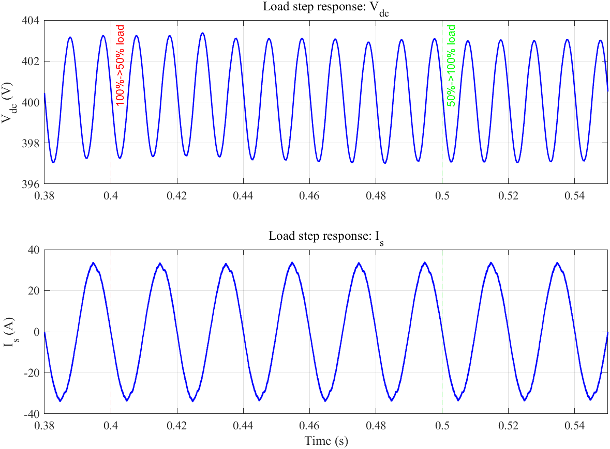

# Single-Phase PWM Rectifier Simulation

MATLAB/Simulink simulation of a single-phase PWM rectifier with a 220 V RMS, 50 Hz AC input, a 400 V DC bus, and a rated output power of 5 kW. The project includes simulation scripts, a Simulink model, parameter data, and saved simulation results.

The full pipeline calculates parameters, rebuilds the model, runs the simulation, and exports performance metrics and plots.

## Requirements

The project was developed for MATLAB R2024a with Simulink, Simscape, and Simscape Electrical (Specialized Power Systems). Model generation uses the `sps_lib` and `powerlib` libraries and the Stateflow API for MATLAB Function blocks. The FFT utility uses `hanning` from Signal Processing Toolbox.

The model builder uses release-specific library paths. Compatibility with other MATLAB releases has not been verified.

## Repository contents

```text
code/
  main.m                     Full simulation and analysis pipeline
  params_calc.m              Electrical and control parameter calculation
  build_model.m              Programmatic Simulink model generation
  run_simulation.m           Model rebuild, simulation, and signal export
  analyze_results.m          Metrics, plots, and CSV export
  utils/
    calc_pf.m                Input power factor
    calc_thd.m               Input current harmonic analysis
    calc_efficiency.m        Input/output power and efficiency
model/
  pwm_rectifier.slx          Saved Simulink model
  pwm_rectifier_params.mat   Parameter structure P
  *.png                     Model screenshot
results/
  data/
    simulation_results.mat   Saved waveforms and simulation parameters
  figures/
    fig1_startup.png
    fig2_steady_vi.png
    fig3_current_fft.png
    fig4_dc_ripple.png
    fig5_load_step.png
    fig6_performance.png
    fig7_power.png
  tables/
    performance_summary.csv  Saved performance metrics
```

## Quick start

Clone the repository and open MATLAB in its root directory:

```sh
git clone https://github.com/HIMHANDSOME/single-phase-pwm-rectifier.git
cd single-phase-pwm-rectifier
```

Run the complete pipeline from the MATLAB command window:

```matlab
addpath('code');
addpath(fullfile('code', 'utils'));
main;
```

Alternatively, run from a terminal with MATLAB available on `PATH`:

```sh
matlab -batch "addpath('code'); addpath(fullfile('code','utils')); main"
```

Running `main` regenerates the saved parameter file, model, simulation data, figures, and performance table.

To analyze the included data without rerunning the simulation:

```matlab
addpath('code');
addpath(fullfile('code', 'utils'));
analyze_results;
```

To execute individual stages:

```matlab
params_calc;       % Calculate and save parameters.
build_model;       % Build the model using the saved parameters.
run_simulation;    % Rebuild the model and run the simulation.
analyze_results;  % Analyze the saved waveforms and export results.
```

Scripts resolve output paths relative to their own location. Edit `code/params_calc.m` to change the design parameters, then rerun `main`.

## Model and control

The power circuit uses an input RL branch, a single-phase IGBT full bridge, a DC-link capacitor, and a switched resistive load. An outer voltage PI loop provides the input-current amplitude reference. An inner current PI loop uses grid-voltage and reference-current derivative feedforward. A separate bipolar SPWM block generates the bridge gate signals.

| Parameter | Default value |
| --- | --- |
| AC input | 220 V RMS, 50 Hz |
| DC voltage reference | 400 V |
| Rated output power | 5 kW |
| Input inductance | 5 mH |
| Input series resistance | 0.1 ohm |
| DC-link capacitance | 6800 uF |
| Equivalent full-load resistance | 32 ohm |
| Switching frequency | 10 kHz |
| Controller sample time | 100 us |
| SPWM sample time | 2 us |
| Current PI gains | Kp = 2, Ki = 2000 |
| Voltage PI gains | Kp = 0.5, Ki = 10 |
| Simulation duration | 0.60 s |
| Solver | ode23tb, variable step |
| Maximum solver step | 10 us |

Grid synchronization uses the known grid frequency and simulation time. The stored optional PLL parameters are not used by the active controller.

## Simulation sequence

| Time | Event |
| --- | --- |
| 0.00-0.03 s | DC reference remains near the AC voltage peak |
| 0.03-0.15 s | DC reference ramps to 400 V |
| 0.15-0.40 s | Full-load operation |
| 0.40 s | Load changes from 100% to 50% |
| 0.50 s | Load returns to 100% |
| 0.60 s | Simulation ends |

The DC-link capacitor starts near the AC voltage peak. This is an initial condition in the simulation.

## Included results

The following values come from the committed [performance summary](results/tables/performance_summary.csv). They are saved simulation outputs, rather than hardware measurements or a newly verified simulation run.

| Metric | Saved value | Design target |
| --- | --- | --- |
| Average DC voltage | 398.519 V | 400 V |
| DC voltage ripple, peak to peak | 10.814 V (2.714%) | Less than 1% |
| Input power factor | 0.999577 | At least 0.99 |
| Input current THD | 6.109% | Less than 3% |
| Calculated efficiency | 95.901% | Greater than 94% |
| Average input power | 5175.346 W | - |
| Average output power | 4963.218 W | 5 kW nominal |
| Time to first reach 95% of the DC reference | 0.206746 s | - |

The saved power factor and efficiency exceed their targets. The saved current THD and DC voltage ripple exceed their respective limits.

The analysis script selects the steady-state interval before the first load step. The utilities calculate power factor and efficiency using sample means and estimate THD using resampling, a windowed FFT, and harmonic peak searches. The reported metrics follow those implemented methods.

The MAT result file contains structure `R`, including `Vs`, `Is`, `Vdc`, `Idc`, and `Vdc_ref`. Each signal contains `time` and `signal` fields. The structure also stores parameters `P`, simulation duration, and elapsed simulation time.

### Plots

| File | Description |
| --- | --- |
| `fig1_startup.png` | DC voltage tracking, input current, and grid voltage during startup |
| `fig2_steady_vi.png` | Steady-state input voltage and current |
| `fig3_current_fft.png` | Input current spectrum |
| `fig4_dc_ripple.png` | DC-link voltage ripple |
| `fig5_load_step.png` | DC voltage and input current during load changes |
| `fig6_performance.png` | Calculated metrics compared with design targets |
| `fig7_power.png` | Instantaneous input power and average input/output power |






